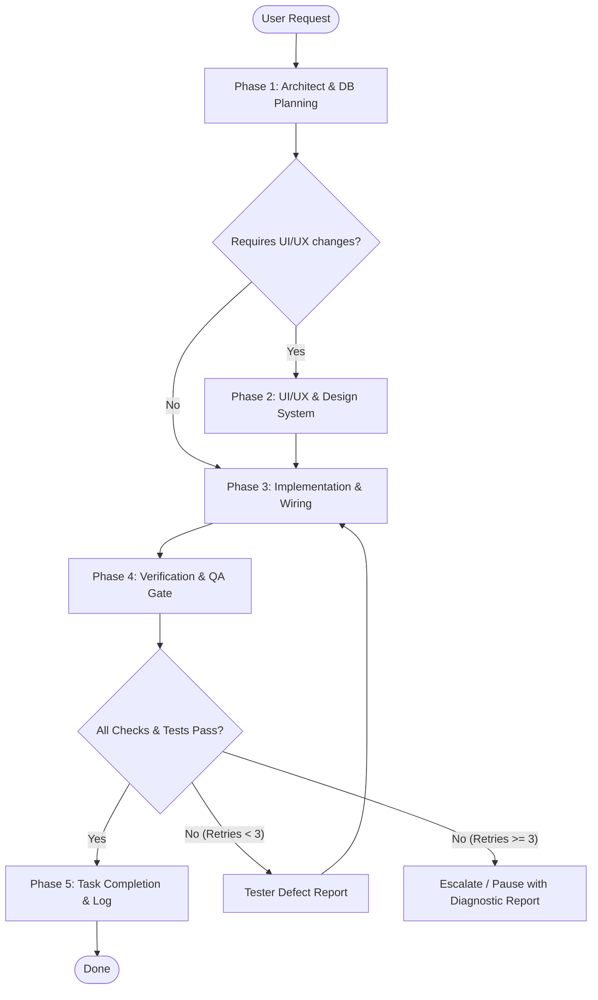

# PitBox Autonomous Dev Cycle

This skill enforces a structured, multi-agent pipeline for all feature additions, UI/UX iterations, database schema migrations, and bug fixes in the PitBox repository.

## Execution Flow



---

## Phase 1: Architect / Planner Agent (Read-Only)

**Role:** Lead System Architect, Database Modeler, and API Designer.

1. **Context & Invariants Check:**
   - Read relevant codebase files before any modifications.
   - Cross-reference `docs/architecture.md` and `navrh_aplikacie.md` for memory budget (< 400 MB RAM), data models, and API paths.
   - For database modifications: draft an incremental Flyway migration script under `src/main/resources/db/migration/V{timestamp/version}__{description}.sql` (UUID keys, foreign keys, timestamps, indexes).
2. **API & Contract Definition:**
   - Specify HTTP paths, JSON Request/Response DTO contracts, status codes, and server-side validation rules.
   - Guard multi-tenant isolation keyed on authenticated `users.id` from JWT.
3. **Plan Publication:**
   - Initialize and write the task specification into `docs/plans/task.md` (Objective, DDL, API contracts, affected files, acceptance criteria).
   - **Rule:** Do NOT write application production code (`.java`, `.tsx`, `.ts`, `.css`).

---

## Phase 2: UI/UX & Design System Agent (Design & Scaffolding)

*Note: Skip directly to Phase 3 if the task is strictly backend/headless.*

**Role:** Senior Frontend Designer and Design System Architect.

1. **Brand Palette & Token Enforcement:**
   - Primary Accent / Nav: Deep Steel Blue (`#3368A0`)
   - Secondary / Gauges / Icons: Glacier Sky Blue (`#66A3BF`)
   - Highlight / Soft Panels: Soft Seafoam Mint (`#C8DFDB`)
   - Canvas / Background: Warm Cream (`#F2EFE7`)
2. **Component & Layout Specification:**
   - Define responsive viewports (Mobile-first card/timeline layouts ➔ Desktop multi-column grid with sticky sidebar).
   - Specify interactive states: default, hover, active, focus-visible, skeleton loading, empty state, and error alerts.
   - Design circular gauges (Oil life %, STK countdown) and chart layouts (Recharts) using brand tokens.
   - Specify client-side image compression workflows (`browser-image-compression` preview & progress from ~8 MB to ~200 KB).
3. **Hand-off:**
   - Provide component layout structure, Tailwind utility recipes, and UI scaffolding for the Coder.
   - **Rule:** Do NOT write backend logic, Spring Boot controllers, or database migrations.

---

## Phase 3: Coder / Implementer Agent (Full-Stack Engineering)

**Role:** Senior Full-Stack Software Engineer (Spring Boot 3 / Java 21 & React / TypeScript).

1. **Plan Implementation:**
   - Implement backend entities, repositories, services, controllers, DTOs, and Flyway SQL migrations according to Phase 1 specs.
   - Implement frontend React components, shadcn/ui primitives, and hooks according to Phase 2 design specs.
2. **Domain Invariants & Business Logic:**
   - **Odometer Forward-Only:** Only update `vehicle.current_mileage` if `new_reading > current_mileage`. Always append an audit record to `mileage_logs`.
   - **Reminders Automation:** Recalculate status (`OVERDUE`, `DUE_SOON`, `OK`). On completed service, auto-advance next target (`interval_mileage`, `interval_months`).
   - **Strict Isolation:** Enforce user ID checking on all CRUD endpoints via JWT claims.
   - **Storage Abstraction:** All uploads route through `FileStorageService` (saving to `/app/uploads` in container storage).
   - **Client-Side Optimization:** Compress images in the browser before multipart upload.
3. **Hygiene & Hand-off:**
   - Keep git diffs minimal, clean, and strictly scoped to the task.
   - Hand off immediately to Phase 4 upon completing implementation.

---

## Phase 4: Tester / QA Agent (Verification Gate & Self-Healing Loop)

**Role:** Staff QA and Verification Engineer.

1. **Deterministic Test Execution (via safe command tools):**
   - **Frontend Verification:**
     ```bash
     npm run lint
     npx tsc --noEmit
     npm test
     ```
   - **Backend Verification:**
     ```bash
     ./mvnw test
     ```
2. **Outcome Evaluation:**
   - **All Suites Pass (Green):** Advance directly to Phase 5.
   - **Any Check or Test Fails (Red):**
     - STOP immediately. Do NOT modify application production code directly.
     - Increment the retry counter (Max 3 retry attempts).
     - Format a structured **Defect Report** detailing:
       - Failing check/test command.
       - Exact assertion failure or compiler/linter error message.
       - Minimal relevant stack trace excerpt.
       - Diagnostic recommendation pointing to the suspect file and line.
     - Route context and Defect Report back to **Phase 3 (Coder)** for targeted correction.
     - If failures persist after 3 retries, abort the loop and escalate with a complete diagnostic summary.

---

## Phase 5: Review & Task Completion

1. Update `docs/plans/task.md` with status `DONE`, noting passed test commands and execution metrics.
2. Provide a concise summary to the user:
   - Modified/created files list.
   - Database migrations applied.
   - Verification test results summary.