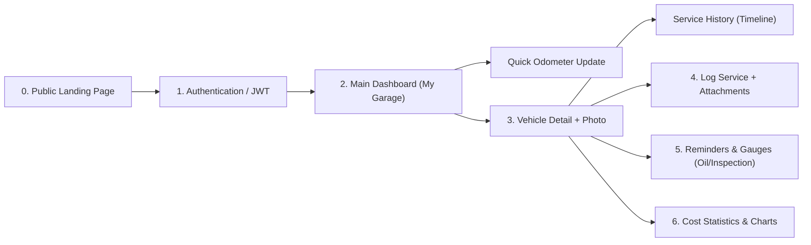
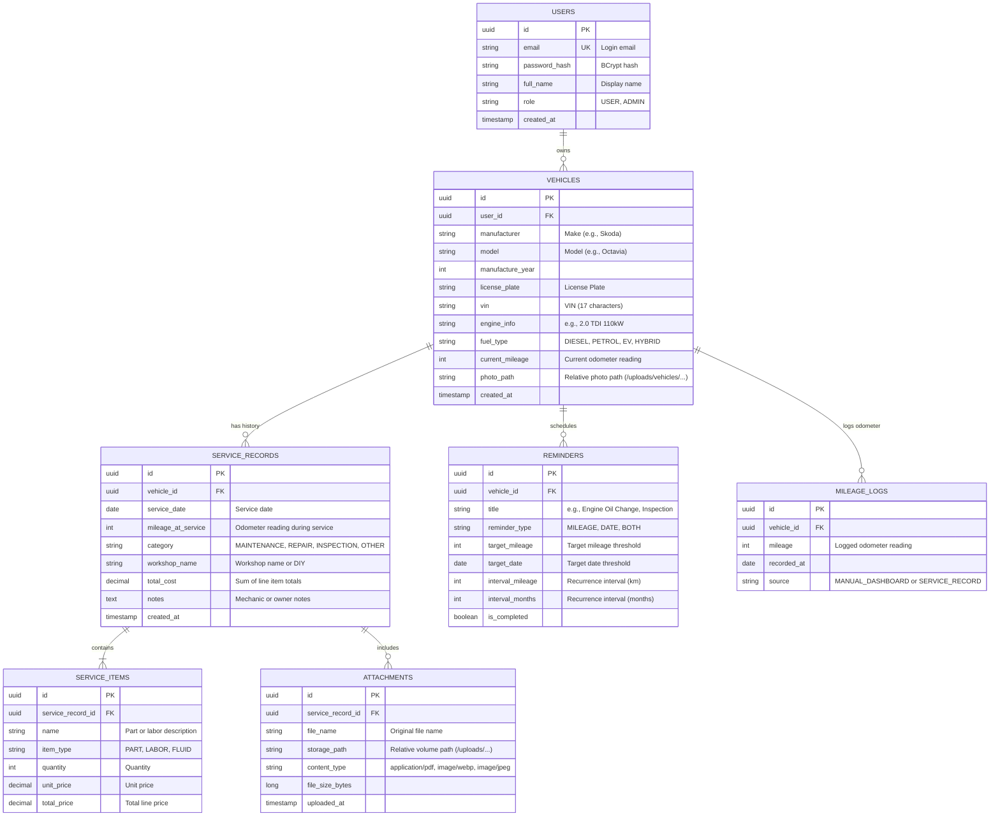

# PitBox – Digital Service Book Concept and Architecture

This document summarizes the outcomes of the initial interview and converts them into the finalized operational design, database schema, visual identity, and lightweight technology stack for the **PitBox** application.

---

## 1. User Flows & Screen Specifications

For the average vehicle owner, the application must be visually appealing and straightforward—ranging from the public Landing Page to an informative vehicle dashboard featuring photos and circular gauge indicators.

### Core Application Screens:

0. **Public Landing Page (Unauthenticated Users)**
   - **Hero Section:** Introduction to **PitBox**, brand slogan (e.g., *"Your digital service book and vehicle history in one place"*), visual dashboard preview, and clear CTA buttons: **Sign In** / **Create Account**.
   - **Value Proposition (3–4 Cards):** Service & invoice tracking, automated oil and state inspection alerts, and real-time total cost of ownership visibility.
   - **Smart Redirection:** If an authenticated user visits `/` with an active JWT session, the system automatically redirects them to the dashboard (or provides a *"Go to My Garage"* button).

1. **My Garage (Main Dashboard)**
   - **Vehicle Cards:** Displays the user's vehicles with **custom uploaded vehicle photos** (or fallback silhouette vectors), make, model, license plate, and current odometer reading.
   - **Quick Odometer Update:** Inline "Update Mileage" button on each card for fast entry (e.g., advancing from `142,300 km` to `144,100 km`), immediately recalculating all mileage-dependent reminders.
   - **Alert Indicators & Circular Gauges:** Visual progress dials (e.g., *Oil Life remaining % / km* and *Days until Inspection countdown*).

2. **Vehicle Detail (Car Profile)**
   - Hero header featuring the vehicle photo, core technical specifications (VIN, engine code, power output, fuel type, model year), and photo upload controls.
   - Tabbed layout: **Service History**, **Reminders & Intervals**, **Costs & Analytics**, **Documents & Gallery**.

3. **Service History & Service Entry (Master-Detail)**
   - Rendered as a **vertical timeline** ordered chronologically (newest to oldest), featuring category badges, workshop names, and attachment thumbnails.
   - **"New Service Entry" Form:**
     - **Header Details:** Date, odometer reading at service, category (*Routine Maintenance / Repair / Inspection / Performance Tuning*), workshop name (or "Self-Service/DIY"), and technician notes.
     - **Line Items (Dynamic List):** Dynamic row builder with `+ Add Item` (e.g., *Engine Oil 5W-30 – €45*, *Oil Filter – €12*, *Labor – €30*). Totals auto-calculate in real time.
     - **Attachments (Drag & Drop):** PDF invoice and receipt uploads, and work photos. Images are automatically compressed in-browser before upload (reducing ~8 MB phone photos to ~200 KB).

4. **Reminders & Maintenance Intervals**
   - Three reminder types supported:
     1. **Date-only:** e.g., *Annual State Inspection (STK/MOT)*, *Highway Toll Sticker*, *Insurance Renewal*.
     2. **Mileage-only:** e.g., *Brake Pad Inspection every 20,000 km*.
     3. **Hybrid (Whichever occurs first):** e.g., *Engine Oil Change every 15,000 km OR 12 months*.
   - **Smart Service Linking:** When a user logs a service entry and marks an associated reminder as completed (e.g., *Engine Oil Change*), the reminder automatically advances to the next interval (`current_mileage + 15,000 km`, `service_date + 12 months`).

5. **Cost Statistics & Analytics (TCO – Total Cost of Ownership)**
   - **KPI Cards:** Total lifetime service expenditure, average monthly ownership cost, cost-per-kilometer, and total service visit count.
   - **Visualizations:** Monthly/annual cost breakdown bar charts and spending distribution by category.

---

## 2. Visual Identity & Color Palette (PitBox)

---

## 3. Database Architecture (PostgreSQL ER Diagram)

This schema supports built-in user management with stateless JWT authentication, vehicles with user photo storage paths, master-detail service records, file attachments, and automated recurring reminders.

---

## 4. Lightweight Technology Stack (Zero-Cost, < 400 MB RAM for ~20 Users)

Eliminating heavyweight identity providers (Keycloak) and object stores (MinIO) reclaims over **1.2 GB of RAM**, allowing the entire system to run comfortably on low-resource home servers or free-tier cloud environments.

### Estimated RAM Footprint:

| Container / Service | Technology | RAM Allocation (~20 users) | Notes |
| :--- | :--- | :--- | :--- |
| **Database** | `postgres:16-alpine` | **~35 – 60 MB** | Extremely lightweight Alpine base |
| **Frontend + Web Server** | `nginx:alpine` (Static React build) | **~10 – 15 MB** | No Node.js runtime in production; compiled assets only |
| **Backend** | `Spring Boot 3` (Java 21 JRE Alpine) | **~220 – 300 MB** | Configured with `-Xmx256m` (or **~60 MB** via GraalVM Native Image) |
| **TOTAL SYSTEM** | **3 Lightweight Containers** | **~270 – 375 MB RAM** | Runs comfortably on a Raspberry Pi or low-spec VPS |

> [!TIP]
> **Zero-Cost Secure Remote Access:**
> Using a **Cloudflare Tunnel (`cloudflared`)** (~15 MB RAM) provides end-to-end HTTPS certificates, DDoS mitigation, and external access without exposing router ports or requiring a static public IP.

### Storage Flexibility:
File operations are decoupled behind a `FileStorageService` interface:
- **Local Self-Hosting:** `LocalFileStorageService` writes to a mounted Docker volume at `/app/uploads`.
- **Free Cloud Deployments:** Easily toggleable to S3-compatible alternatives like **Cloudflare R2** (10 GB free tier) or direct database persistence for compressed ~200 KB assets.

### Dependency Manifest:
- **Backend (Spring Boot 3 + Java 21):**
  - `Spring Security + jjwt`: Stateless JWT authentication and `BCryptPasswordEncoder`.
  - `Spring Data JPA + Flyway`: PostgreSQL persistence with incremental database migrations on startup.
  - `Spring Web + Validation`: REST API and request payload validation (`jakarta.validation`).
- **Frontend (React + TypeScript + Vite):**
  - `Tailwind CSS + shadcn/ui`: Themed to the PitBox brand palette (`#3368A0`, `#66A3BF`, `#C8DFDB`, `#F2EFE7`).
  - `browser-image-compression`: Client-side compression pipeline reducing 8 MB mobile photos to ~200 KB WebP/JPEG files prior to transport.
  - `TanStack Query (React Query)` + `Axios`: Server state management and automated caching.
  - `React Hook Form + Zod`: Dynamic schema-validated forms.
  - `Recharts`: Composable expense analytics charts.

---

## 5. Domain Rules & Core Invariants

1. **Odometer Forward-Only Invariance:**
   - If a vehicle currently has an odometer reading of `150,000 km` and the user logs a service dated today at `152,400 km`, the backend updates `vehicle.current_mileage = 152400` and creates an audit entry in `MILEAGE_LOGS`.
   - If a user retroactively logs a past invoice from last year (e.g., at `130,000 km`), `vehicle.current_mileage` remains untouched at `152,400 km`.
2. **Reminder Threshold Engine:**
   - Dynamic reminder evaluations calculate remaining units and statuses:
     - `OVERDUE` (Red): `current_mileage >= target_mileage` OR `current_date >= target_date`.
     - `DUE_SOON` (Amber): `target_mileage - current_mileage <= 1,000 km` OR `target_date - current_date <= 30 days`.
     - `OK` (Green/Blue): Default valid status.
3. **Multi-Tenant Isolation:**
   - Every API query resolves `user_id` strictly from the authenticated JWT `SecurityContextHolder`. Cross-tenant data access attempts return `403 Forbidden`.

---

## 6. Implementation Roadmap

1. **Step 1 – Foundations & Environment:** Configure `docker-compose.yml` (Postgres, Backend, Frontend). Initialize Spring Boot 3 with Flyway and React + Vite with Tailwind CSS and PitBox tokens.
2. **Step 2 – Public Landing Page & JWT Auth:** Implement unauthenticated landing screen (`/`), authentication routes (`/login`, `/register`), and token-protected private route guards.
3. **Step 3 – Garage & Vehicle Management:** Vehicle CRUD endpoints, client-side photo compression, profile image uploads, and quick odometer updates.
4. **Step 4 – Service Records (Master-Detail):** Dynamic line-item entry form, cost calculation, service category filtering, and odometer auto-advance logic.
5. **Step 5 – File Attachments & Gallery:** Multi-file upload handlers, local volume persistence via `FileStorageService`, and timeline attachment previews.
6. **Step 6 – Reminders, Gauges, & Analytics:** Dynamic interval calculation engines, SVG progress gauges (Oil Life, STK inspection), and Recharts expense visualizers.