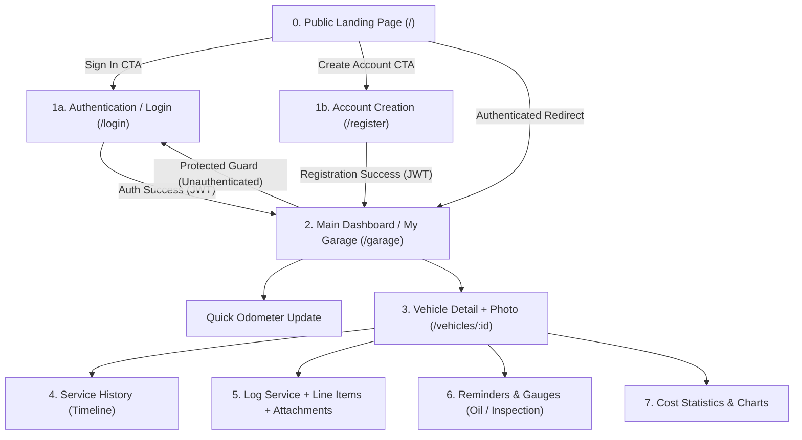
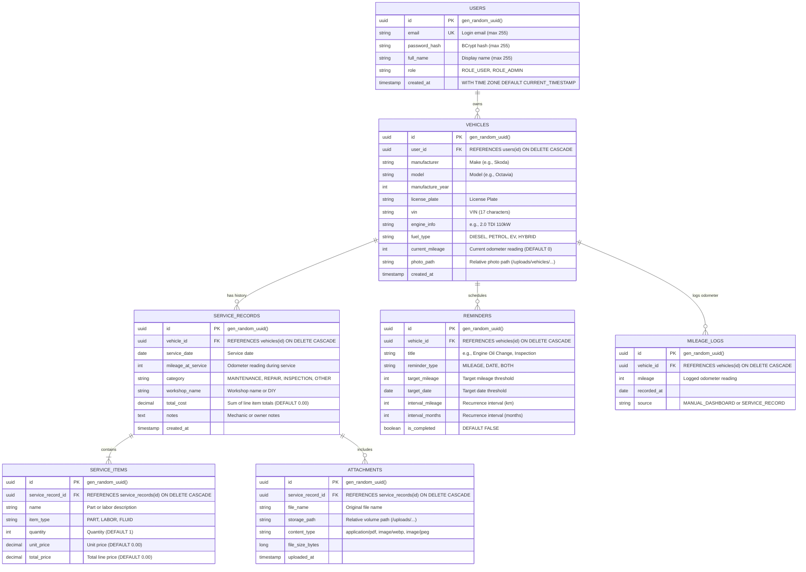
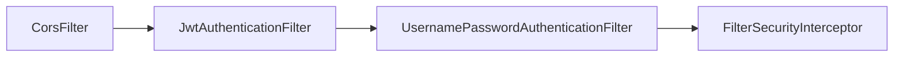

# PitBox – Digital Service Book Concept and Architecture

This document summarizes the system design, relational database schema, visual identity, lightweight technology stack, and implemented API contracts for the **PitBox** application.

---

## 1. User Flows & Screen Specifications

For the vehicle owner, the application provides an intuitive workflow—ranging from the public Landing Page to an informative vehicle dashboard featuring photos and circular gauge indicators.

### Core Application Screens:

0. **Public Landing Page (Unauthenticated Users, `/`)**
   - **Hero Section:** Introduction to **PitBox**, brand slogan (*"Your digital service book and vehicle history in one place"*), visual dashboard preview teaser, and CTA buttons: **Sign In** / **Create Account**.
   - **Value Proposition (3 Cards):** Service & invoice tracking, automated oil and state inspection alerts, and real-time total cost of ownership visibility.
   - **Smart Redirection:** If an authenticated user visits `/` with an active JWT session in `localStorage`, the frontend displays a *"Go to My Garage"* button or automatically redirects to `/garage`.

1. **Authentication Screens (`/login`, `/register`)**
   - **Login Page (`/login`):** Email and password inputs, form validation, error banner display, and navigation link to registration.
   - **Register Page (`/register`):** Full name, email, and password inputs (minimum 6 characters), instant validation feedback, and direct redirection to `/garage` upon token issuance.

2. **My Garage (Main Dashboard, `/garage`)**
   - Guarded via [`ProtectedRoute`](file:///C:/Users/brecka/source/repos/PitBox/frontend/src/components/ProtectedRoute.tsx).
   - **Vehicle Cards:** Displays the user's vehicles with custom uploaded photos (or fallback silhouette), make, model, license plate, and current odometer reading.
   - **Quick Odometer Update:** Inline "Update Mileage" button on each card for fast entry, immediately recalculating all mileage-dependent reminders.
   - **Alert Indicators & Circular Gauges:** Visual progress dials (*Oil Life remaining % / km* and *Days until Inspection countdown*).

3. **Vehicle Detail (Car Profile)**
   - Hero header featuring the vehicle photo, core technical specifications (VIN, engine code, power output, fuel type, model year), and photo upload controls.
   - Tabbed layout: **Service History**, **Reminders & Intervals**, **Costs & Analytics**, **Documents & Gallery**.

4. **Service History & Service Entry (Master-Detail)**
   - Rendered as a **vertical timeline** ordered chronologically (newest to oldest), featuring category badges, workshop names, and attachment thumbnails.
   - **"New Service Entry" Form:**
     - **Header Details:** Date, odometer reading at service, category (*Routine Maintenance / Repair / Inspection / Performance Tuning*), workshop name (or "Self-Service/DIY"), and technician notes.
     - **Line Items (Dynamic List):** Dynamic row builder with `+ Add Item` (e.g., *Engine Oil 5W-30 – €45*, *Oil Filter – €12*, *Labor – €30*). Totals auto-calculate in real time.
     - **Attachments (Drag & Drop):** PDF invoice and receipt uploads, and work photos. Images are automatically compressed in-browser before upload (reducing ~8 MB phone photos to ~200 KB).

5. **Reminders & Maintenance Intervals**
   - Three reminder types supported:
     1. **Date-only:** e.g., *Annual State Inspection (STK/MOT)*, *Highway Toll Sticker*, *Insurance Renewal*.
     2. **Mileage-only:** e.g., *Brake Pad Inspection every 20,000 km*.
     3. **Hybrid (Whichever occurs first):** e.g., *Engine Oil Change every 15,000 km OR 12 months*.
   - **Smart Service Linking:** When a user logs a service entry and marks an associated reminder as completed (e.g., *Engine Oil Change*), the reminder automatically advances to the next interval (`current_mileage + interval_mileage`, `service_date + interval_months`).

6. **Cost Statistics & Analytics (TCO – Total Cost of Ownership)**
   - **KPI Cards:** Total lifetime service expenditure, average monthly ownership cost, cost-per-kilometer, and total service visit count.
   - **Visualizations:** Monthly/annual cost breakdown bar charts and spending distribution by category.

---

## 2. Visual Identity & Color Palette (PitBox)

PitBox uses a targeted color palette engineered for high contrast, clean automotive service dashboards, and clear status communication:

| Token Name | Hex Code | Role / Usage |
| :--- | :--- | :--- |
| `pitbox-steel` | `#3368A0` | Primary brand accent, top navbar background, primary CTAs, active highlights |
| `pitbox-glacier` | `#66A3BF` | Secondary brand color, gauge indicators, chart series, secondary action icons |
| `pitbox-seafoam` | `#C8DFDB` | Soft panel backgrounds, card borders, timeline headers, status pill badges |
| `pitbox-cream` | `#F2EFE7` | Viewport base background canvas, warm neutral page fill |
| `pitbox-dark` | `#1C2E42` | Primary typography color, high-contrast headings, text labels |
| `white` | `#FFFFFF` | Elevated container cards, modals, popovers |

**Typography:** Standardized sans-serif font stack (`Inter`, `system-ui`, `-apple-system`, `sans-serif`) optimized for legibility across mobile and desktop viewports.

---

## 3. Database Architecture (PostgreSQL ER Diagram)

This schema supports built-in user management with stateless JWT authentication, vehicles with user photo storage paths, master-detail service records, file attachments, and automated recurring reminders.

### Physical Database Migration (Flyway V1)
Implemented via Flyway migration [`V1__initial_schema.sql`](file:///C:/Users/brecka/source/repos/PitBox/backend/src/main/resources/db/migration/V1__initial_schema.sql):
- **Primary Keys:** UUID v4 default `gen_random_uuid()`.
- **Foreign Keys:** Cascading deletes (`ON DELETE CASCADE`) bound to parent records (`users`, `vehicles`, `service_records`).
- **Indexes:** Foreign key coverage on `idx_vehicles_user_id`, `idx_mileage_logs_vehicle_id`, `idx_service_records_vehicle_id`, `idx_service_items_record_id`, `idx_attachments_record_id`, and `idx_reminders_vehicle_id`.
- **Audit Fields:** `created_at TIMESTAMP WITH TIME ZONE DEFAULT CURRENT_TIMESTAMP`.

---

## 4. Lightweight Technology Stack & Architectural Trade-offs

Eliminating heavyweight identity providers (Keycloak) and object stores (MinIO) reclaims over **1.2 GB of RAM**, allowing the entire system to run comfortably on low-resource home servers or free-tier cloud environments.

### 4.1 Estimated RAM Footprint:

| Container / Service | Technology | RAM Allocation (~20 users) | Notes |
| :--- | :--- | :--- | :--- |
| **Database** | `postgres:16-alpine` | **~35 – 60 MB** | Extremely lightweight Alpine base |
| **Frontend + Web Server** | `nginx:alpine` (Static React build) | **~10 – 15 MB** | No Node.js runtime in production; compiled assets only |
| **Backend** | `Spring Boot 3` (Java 21 JRE Alpine) | **~220 – 300 MB** | Configured with `-Xmx256m` (or **~60 MB** via GraalVM Native Image) |
| **TOTAL SYSTEM** | **3 Lightweight Containers** | **~270 – 375 MB RAM** | Runs comfortably on a Raspberry Pi or low-spec VPS |

> [!TIP]
> **Zero-Cost Secure Remote Access:**
> Using a **Cloudflare Tunnel (`cloudflared`)** (~15 MB RAM) provides end-to-end HTTPS certificates, DDoS mitigation, and external access without exposing router ports or requiring a static public IP.

### 4.2 Storage Flexibility:
File operations are decoupled behind a `FileStorageService` interface:
- **Local Self-Hosting:** `LocalFileStorageService` writes to a mounted Docker volume at `/app/uploads`.
- **Free Cloud Deployments:** Easily toggleable to S3-compatible alternatives like **Cloudflare R2** (10 GB free tier) or direct database persistence for compressed ~200 KB assets.

### 4.3 Environment Configuration & Secrets Matrix:

System parameters are externalized in `.env` (template in [`.env.example`](file:///C:/Users/brecka/source/repos/PitBox/.env.example)) and injected via [`docker-compose.yml`](file:///C:/Users/brecka/source/repos/PitBox/docker-compose.yml):

| Variable | Default / Example | Target Container | Purpose |
| :--- | :--- | :--- | :--- |
| `POSTGRES_DB` | `pitbox` | `postgres`, `backend` | PostgreSQL database name |
| `POSTGRES_USER` | `pitbox` | `postgres`, `backend` | PostgreSQL database user |
| `POSTGRES_PASSWORD` | `pitbox_secure_password_change_me` | `postgres`, `backend` | PostgreSQL database password |
| `POSTGRES_PORT` | `5432` | `postgres` (host) | External host port mapping |
| `BACKEND_PORT` | `8080` | `backend` (host) | External host port mapping for Spring Boot |
| `FRONTEND_PORT` | `80` | `frontend` (host) | External host port mapping for Nginx |
| `JWT_SECRET` | `replace_with_a_secure_256_bit_secret...` | `backend` | Secret used for HMAC-SHA256 JWT signing key |
| `JWT_EXPIRATION_MS` | `86400000` (24 hours) | `backend` | JWT access token lifespan in milliseconds |
| `UPLOAD_DIR` | `/app/uploads` | `backend` | Mounted volume directory path for uploads |
| `JAVA_OPTS` | `-Xms64m -Xmx256m -XX:+UseG1GC` | `backend` | JRE memory & GC tuning enforcing < 400 MB RAM budget |

### 4.4 Architectural Decisions & Trade-Offs (ADR)

1. **ADR-01: Stateless HMAC-SHA256 JWT Authentication over Stateful HTTP Sessions**
   - *Context:* The application target is < 400 MB RAM total. Traditional server-side sessions (e.g. `HttpSession` or Redis-backed sessions) consume heap or external memory.
   - *Decision:* Adopt stateless JWT with HMAC-SHA256 signing via `io.jsonwebtoken (jjwt)`. Session policy is `STATELESS`. Tenant context is evaluated per-request via `JwtAuthenticationFilter`.
   - *Trade-off:* Token revocation before the 24-hour expiration window requires client-side deletion from `localStorage` unless a token blocklist is introduced in future iterations.
2. **ADR-02: Zero-Dependency Client-Side Router over External Libraries**
   - *Context:* Avoid unnecessary dependencies and bloat for a streamlined 4-route SPA (`/`, `/login`, `/register`, `/garage`).
   - *Decision:* Implemented a native React HTML5 History API router ([`Router.tsx`](file:///C:/Users/brecka/source/repos/PitBox/frontend/src/router/Router.tsx)) providing `useRouter`, `useNavigate`, `Link`, and `Routes`.
   - *Trade-off:* Complex nested dynamic route matching is not supported out of the box, but satisfies 100% of current and planned views with minimal bundle footprint (~3 KB).
3. **ADR-03: Embedded BCrypt Hashing over External Identity Provider**
   - *Context:* Operating Keycloak or Authentik requires 800 MB to 1.5 GB RAM.
   - *Decision:* Embed authentication directly in Spring Boot using Spring Security's `BCryptPasswordEncoder` (cost factor 10).
   - *Trade-off:* Social logins (OAuth2/OIDC) require custom integration rather than out-of-the-box provider toggles.
4. **ADR-04: Centralized Error Envelope Response**
   - *Context:* Clean frontend error handling requires consistent error structures across validation, authentication, and domain failures.
   - *Decision:* Implemented [`GlobalExceptionHandler`](file:///C:/Users/brecka/source/repos/PitBox/backend/src/main/java/com/pitbox/exception/GlobalExceptionHandler.java) mapping standard Spring exceptions to `{ "error": string, "details"?: map }`.

---

## 5. Domain Rules & Core Invariants

1. **Odometer Forward-Only Invariance:**
   - If a vehicle currently has an odometer reading of `150,000 km` and the user logs a service dated today at `152,400 km`, the backend updates `vehicle.current_mileage = 152400` and creates an audit entry in `MILEAGE_LOGS`.
   - If a user retroactively logs a past invoice from last year (e.g., at `130,000 km`), `vehicle.current_mileage` remains untouched at `152,400 km`.
2. **Reminder Threshold Engine:**
   - Dynamic reminder evaluations calculate remaining units and statuses:
     - `OVERDUE` (Red): `current_mileage >= target_mileage` OR `current_date >= target_date`.
     - `DUE_SOON` (Amber): `target_mileage - current_mileage <= 1,000 km` OR `target_date - current_date <= 30 days`.
     - `OK` (Green/Blue): Default valid status.
3. **Multi-Tenant Isolation:**
   - Every API query resolves `user_id` strictly from the authenticated JWT `SecurityContextHolder`. Cross-tenant data access attempts return `403 Forbidden`.

---

## 6. Implementation Roadmap

1. **Step 1 – Foundations & Environment:** `[COMPLETED]`
   - Configured [`docker-compose.yml`](file:///C:/Users/brecka/source/repos/PitBox/docker-compose.yml) orchestrating `postgres:16-alpine`, `pitbox-backend` (Spring Boot 3.3.5), and `pitbox-frontend` (Nginx + React 18).
   - Applied Flyway migration [`V1__initial_schema.sql`](file:///C:/Users/brecka/source/repos/PitBox/backend/src/main/resources/db/migration/V1__initial_schema.sql) defining relational schema with UUIDs, cascade constraints, and indexes.
   - Externalized configuration to [`.env.example`](file:///C:/Users/brecka/source/repos/PitBox/.env.example) and parameterized memory limits (`JAVA_OPTS: -Xmx256m`, Docker memory limits).
   - Implemented public health endpoint [`/api/health`](file:///C:/Users/brecka/source/repos/PitBox/backend/src/main/java/com/pitbox/controller/HealthController.java) and stateless [`SecurityConfig`](file:///C:/Users/brecka/source/repos/PitBox/backend/src/main/java/com/pitbox/config/SecurityConfig.java) baseline.
   - Built React frontend scaffolding with Tailwind tokens (`#3368A0`, `#66A3BF`, `#C8DFDB`, `#F2EFE7`, `#1C2E42`) and Vitest test harness.
2. **Step 2 – Public Landing Page & JWT Auth:** `[COMPLETED]`
   - Implemented stateless JWT auth backend endpoints: `POST /api/auth/register`, `POST /api/auth/login`, `GET /api/auth/me` with [`AuthController`](file:///C:/Users/brecka/source/repos/PitBox/backend/src/main/java/com/pitbox/controller/AuthController.java), [`AuthService`](file:///C:/Users/brecka/source/repos/PitBox/backend/src/main/java/com/pitbox/service/AuthService.java), and [`JwtAuthenticationFilter`](file:///C:/Users/brecka/source/repos/PitBox/backend/src/main/java/com/pitbox/security/JwtAuthenticationFilter.java).
   - Enforced tenant security via `UserPrincipal` extracted from HMAC-SHA256 tokens (`JwtService`).
   - Built unauthenticated Public Landing Page ([`LandingPage.tsx`](file:///C:/Users/brecka/source/repos/PitBox/frontend/src/pages/LandingPage.tsx)) with PitBox token styling, vehicle preview teaser, and feature value proposition cards.
   - Built authentication screens ([`LoginPage.tsx`](file:///C:/Users/brecka/source/repos/PitBox/frontend/src/pages/LoginPage.tsx), [`RegisterPage.tsx`](file:///C:/Users/brecka/source/repos/PitBox/frontend/src/pages/RegisterPage.tsx)) and guarded routes via [`ProtectedRoute.tsx`](file:///C:/Users/brecka/source/repos/PitBox/frontend/src/components/ProtectedRoute.tsx) directing to [`GaragePage.tsx`](file:///C:/Users/brecka/source/repos/PitBox/frontend/src/pages/GaragePage.tsx).
   - Zero-dependency client-side history router ([`Router.tsx`](file:///C:/Users/brecka/source/repos/PitBox/frontend/src/router/Router.tsx)) and [`AuthContext.tsx`](file:///C:/Users/brecka/source/repos/PitBox/frontend/src/context/AuthContext.tsx).
   - Dedicated subsystem specification: [docs/auth-and-security.md](auth-and-security.md).
3. **Step 3 – Garage & Vehicle Management:** `[COMPLETED]`
   - Implemented Vehicle CRUD REST endpoints (`GET /api/vehicles`, `GET /api/vehicles/{id}`, `POST /api/vehicles`, `PUT /api/vehicles/{id}`, `DELETE /api/vehicles/{id}`).
   - Implemented forward-only odometer engine with `PATCH /api/vehicles/{id}/mileage` and `GET /api/vehicles/{id}/mileage-logs` appending immutable audit logs to `MILEAGE_LOGS`.
   - Built media upload and storage abstraction with `FileStorageService` and `LocalFileStorageService`, static WebMvc resource handler `/uploads/**`, and multipart upload/delete endpoints (`POST /api/vehicles/{id}/photo`, `DELETE /api/vehicles/{id}/photo`).
   - Built frontend Garage dashboard (`GaragePage.tsx`), Vehicle cards (`VehicleCard.tsx`), Vehicle creation/edit modal (`VehicleModal.tsx`), Quick odometer update modal (`QuickMileageModal.tsx`), and full car profile view (`VehicleDetailPage.tsx`).
   - Integrated client-side in-browser image compression with `browser-image-compression` (~8 MB down to ~200 KB) before upload.
   - Enhanced zero-dependency client-side router (`Router.tsx`) with route parameter pattern matching (`/vehicles/:id`) and `useParams()`.
   - Dedicated subsystem specifications: [docs/features/mileage-engine.md](features/mileage-engine.md), [docs/features/media-upload.md](features/media-upload.md), [docs/api-reference.md](api-reference.md), and [docs/database.md](database.md).
4. **Step 4 – Service Records (Master-Detail):** Dynamic line-item entry form, cost calculation, service category filtering, and odometer auto-advance logic.
5. **Step 5 – File Attachments & Gallery:** Multi-file upload handlers, local volume persistence via `FileStorageService`, and timeline attachment previews.
6. **Step 6 – Reminders, Gauges, & Analytics:** Dynamic interval calculation engines, SVG progress gauges (Oil Life, STK inspection), and Recharts expense visualizers.

---

## 7. Implemented API Contracts & Baseline Services

### 7.1 Health Check API

| Attribute | Specification |
| :--- | :--- |
| **HTTP Method & Path** | `GET /api/health` |
| **Controller Class** | [`HealthController`](file:///C:/Users/brecka/source/repos/PitBox/backend/src/main/java/com/pitbox/controller/HealthController.java) |
| **Authentication** | Public (`permitAll`) |
| **Produces** | `application/json` |

#### Response Schema:
| Field | Type | Description |
| :--- | :--- | :--- |
| `status` | `String` | Service operational health status (`"UP"`) |
| `service` | `String` | Identifying service name (`"pitbox-backend"`) |

#### Status Codes:
| HTTP Status | Condition | Example Response |
| :--- | :--- | :--- |
| `200 OK` | Backend application is healthy and responsive | `{"status": "UP", "service": "pitbox-backend"}` |

---

### 7.2 Security Filter Pipeline & Authorization Rules

| Component | Responsibility | Implementation File |
| :--- | :--- | :--- |
| **Security Configuration** | Configures stateless session management, CSRF disable, CORS rules, and URL authorization | [`SecurityConfig.java`](file:///C:/Users/brecka/source/repos/PitBox/backend/src/main/java/com/pitbox/config/SecurityConfig.java) |
| **JWT Filter** | Extracts Bearer token, validates cryptographic signature, loads user, populates `SecurityContext` | [`JwtAuthenticationFilter.java`](file:///C:/Users/brecka/source/repos/PitBox/backend/src/main/java/com/pitbox/security/JwtAuthenticationFilter.java) |
| **JWT Service** | Encapsulates HMAC-SHA256 token issuance, claims parsing, and validation | [`JwtService.java`](file:///C:/Users/brecka/source/repos/PitBox/backend/src/main/java/com/pitbox/security/JwtService.java) |
| **User Principal** | Implements Spring `UserDetails`, holding authenticated user UUID and authorities | [`UserPrincipal.java`](file:///C:/Users/brecka/source/repos/PitBox/backend/src/main/java/com/pitbox/security/UserPrincipal.java) |
| **Password Encoder** | Computes and verifies BCrypt salted hashes (strength 10) | `BCryptPasswordEncoder` bean |

#### Filter Chain Execution Order:

---

### 7.3 Frontend Reverse Proxy Specification

| Route Pattern | Target Destination | Purpose |
| :--- | :--- | :--- |
| `/api/*` | `http://backend:8080/api/*` | Proxies backend REST endpoints while passing host and client IP headers |
| `/uploads/*` | `http://backend:8080/uploads/*` | Proxies uploaded vehicle images and service invoice receipts |
| `/*` (Fallback) | `/usr/share/nginx/html/index.html` | SPA HTML5 fallback (`try_files $uri $uri/ /index.html`) with gzip compression |

---

### 7.4 Authentication & Identity API

> [!NOTE]
> For in-depth cryptographic design, token claim structure, and sequence diagrams, refer to the dedicated specification at [docs/auth-and-security.md](auth-and-security.md).

#### Endpoints Summary:
| HTTP Method & Path | Controller | Description | Access Control |
| :--- | :--- | :--- | :--- |
| `POST /api/auth/register` | [`AuthController.register`](file:///C:/Users/brecka/source/repos/PitBox/backend/src/main/java/com/pitbox/controller/AuthController.java#L29-L33) | Register a new user account | Public (`permitAll`) |
| `POST /api/auth/login` | [`AuthController.login`](file:///C:/Users/brecka/source/repos/PitBox/backend/src/main/java/com/pitbox/controller/AuthController.java#L35-L39) | Authenticate user credentials & issue JWT | Public (`permitAll`) |
| `GET /api/auth/me` | [`AuthController.getCurrentUser`](file:///C:/Users/brecka/source/repos/PitBox/backend/src/main/java/com/pitbox/controller/AuthController.java#L41-L48) | Retrieve authenticated user profile | Bearer Token Required |

---

#### 7.4.1 Register Endpoint (`POST /api/auth/register`)

- **Headers:** `Content-Type: application/json`
- **Request DTO Schema ([`RegisterRequest`](file:///C:/Users/brecka/source/repos/PitBox/backend/src/main/java/com/pitbox/dto/RegisterRequest.java)):**

| Field | Type | Required | Validation Constraints | Description |
| :--- | :--- | :--- | :--- | :--- |
| `email` | `String` | Yes | `@NotBlank`, `@Email` | Unique user email address |
| `password` | `String` | Yes | `@NotBlank`, `@Size(min = 6)` | Raw account password |
| `fullName` | `String` | Yes | `@NotBlank` | Display name of the user |

- **Success Response DTO Schema ([`AuthResponse`](file:///C:/Users/brecka/source/repos/PitBox/backend/src/main/java/com/pitbox/dto/AuthResponse.java)):**

| Field | Type | Description |
| :--- | :--- | :--- |
| `token` | `String` | Signed HMAC-SHA256 JWT access token valid for 24 hours |
| `user` | [`UserDto`](file:///C:/Users/brecka/source/repos/PitBox/backend/src/main/java/com/pitbox/dto/UserDto.java) | User profile representation |
| `user.id` | `UUID` | Primary key identifier |
| `user.email` | `String` | Registered user email |
| `user.fullName` | `String` | Registered user full name |
| `user.role` | `String` | Assigned authority role (e.g., `"ROLE_USER"`) |

- **Status Codes & Error Responses:**
| HTTP Status | Condition | Response Payload Schema / Example |
| :--- | :--- | :--- |
| `201 Created` | Registration successful | `{"token": "<jwt>", "user": {"id": "<uuid>", "email": "user@example.com", "fullName": "Alex Parker", "role": "ROLE_USER"}}` |
| `400 Bad Request` | Validation constraint violation | `{"error": "Validation failed", "details": {"email": "Must be a valid email address", "password": "Password must be at least 6 characters"}}` |
| `409 Conflict` | Email is already registered | `{"error": "Email is already registered"}` |

---

#### 7.4.2 Login Endpoint (`POST /api/auth/login`)

- **Headers:** `Content-Type: application/json`
- **Request DTO Schema ([`LoginRequest`](file:///C:/Users/brecka/source/repos/PitBox/backend/src/main/java/com/pitbox/dto/LoginRequest.java)):**

| Field | Type | Required | Validation Constraints | Description |
| :--- | :--- | :--- | :--- | :--- |
| `email` | `String` | Yes | `@NotBlank`, `@Email` | User login email address |
| `password` | `String` | Yes | `@NotBlank` | User account password |

- **Success Response DTO Schema ([`AuthResponse`](file:///C:/Users/brecka/source/repos/PitBox/backend/src/main/java/com/pitbox/dto/AuthResponse.java)):**
Same schema as registration (`token` + `user`).

- **Status Codes & Error Responses:**
| HTTP Status | Condition | Response Payload Schema / Example |
| :--- | :--- | :--- |
| `200 OK` | Authentication successful | `{"token": "<jwt>", "user": {"id": "<uuid>", "email": "user@example.com", "fullName": "Alex Parker", "role": "ROLE_USER"}}` |
| `400 Bad Request` | Missing required fields | `{"error": "Validation failed", "details": {"email": "Email is required"}}` |
| `401 Unauthorized` | Invalid email or password mismatch | `{"error": "Invalid email or password"}` |

---

#### 7.4.3 Current User Endpoint (`GET /api/auth/me`)

- **Headers:** `Authorization: Bearer <jwt-token>`
- **Request Payload:** None
- **Success Response DTO Schema ([`UserDto`](file:///C:/Users/brecka/source/repos/PitBox/backend/src/main/java/com/pitbox/dto/UserDto.java)):**

| Field | Type | Description |
| :--- | :--- | :--- |
| `id` | `UUID` | Authenticated user primary key identifier |
| `email` | `String` | User email address |
| `fullName` | `String` | User full name |
| `role` | `String` | User role authority (`"ROLE_USER"`) |

- **Status Codes & Error Responses:**
| HTTP Status | Condition | Response Payload Schema / Example |
| :--- | :--- | :--- |
| `200 OK` | Valid Bearer token supplied | `{"id": "c1f7a0b3-...", "email": "user@example.com", "fullName": "Alex Parker", "role": "ROLE_USER"}` |
| `401 Unauthorized` | Missing, malformed, or expired Bearer token | `{"error": "Unauthorized"}` (or empty body on direct security reject) |
