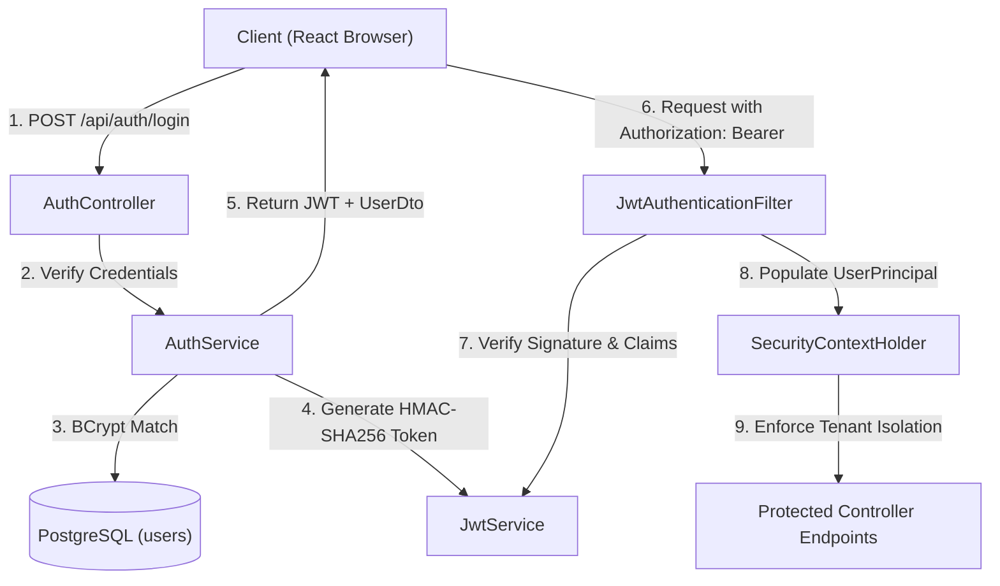
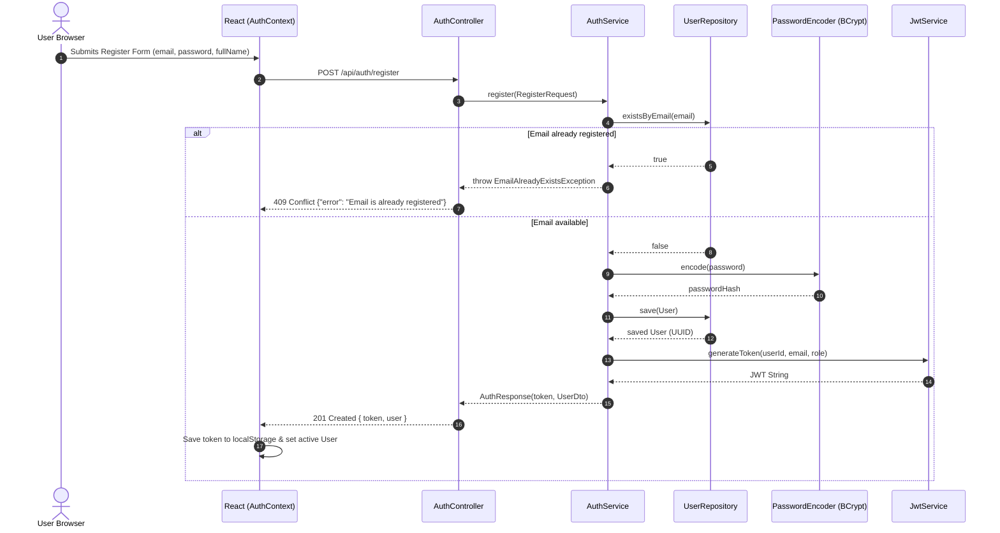
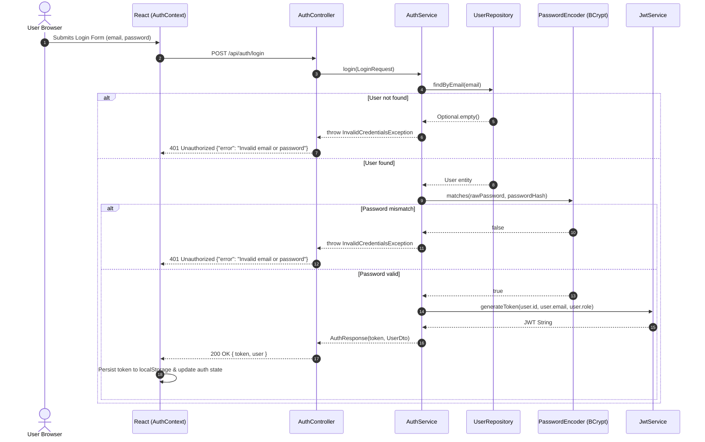
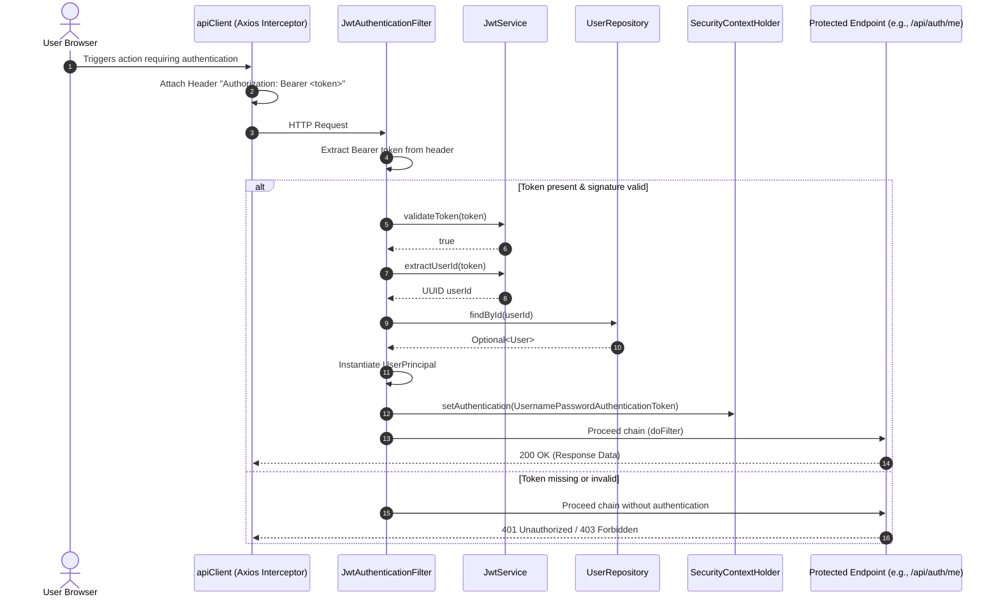
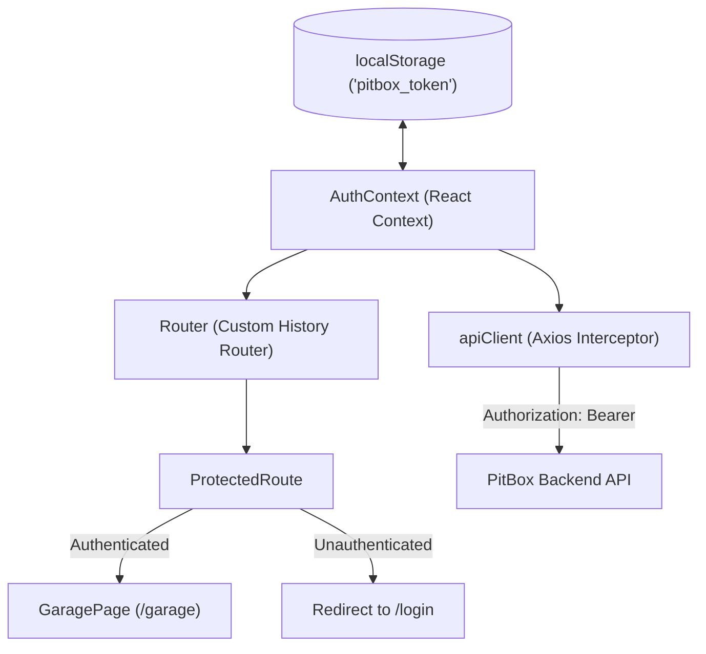

# Authentication & Security Subsystem Specification

This document provides a comprehensive technical specification for the **Stateless JWT Authentication and Security Subsystem** in PitBox. It details the cryptographic standards, security filter pipeline, tenant isolation guarantees, frontend state management, error handling, and interfaces implemented in Step 2.

---

## 1. Architectural Overview & Design Invariants

PitBox operates in resource-constrained environments (target: **< 400 MB RAM total**). The authentication subsystem is designed to provide enterprise-grade tenant security without the memory overhead of stateful HTTP sessions or heavyweight external identity providers (e.g., Keycloak).



### Core Invariants:
1. **Stateless Session Policy:** The Spring Security session creation policy is set to `SessionCreationPolicy.STATELESS`. The backend never stores session states or HTTP session IDs in memory.
2. **Tenant Isolation:** Every request to protected resources must resolve tenant identity (`user_id`) strictly from `UserPrincipal` injected into `SecurityContextHolder`. No client-supplied user ID is ever trusted.
3. **Cryptographic Integrity:** All tokens are signed with HMAC-SHA256 (`HS256`) using a key derived from a minimum 256-bit secret.
4. **Credential Security:** User passwords are never stored in plaintext. They are salted and hashed using Spring Security's `BCryptPasswordEncoder` (default cost factor 10).

---

## 2. Authentication Flow & Sequence Diagrams

### 2.1 User Registration Flow (`POST /api/auth/register`)


### 2.2 User Login Flow (`POST /api/auth/login`)


### 2.3 Authenticated Request & Filter Pipeline


---

## 3. Cryptographic Token Specification

Tokens are stateless JSON Web Tokens (RFC 7519) formatted as `header.payload.signature`.

### 3.1 Token Header
- **Algorithm (`alg`):** `HS256` (HMAC using SHA-256)
- **Type (`typ`):** `JWT`

### 3.2 Token Payload Claims
| Claim | Type | Description | Example |
| :--- | :--- | :--- | :--- |
| `sub` | `String` (UUID v4) | Subject identifier: primary key of the authenticated user (`users.id`). | `"3fa85f64-5717-4562-b3fc-2c963f66afa6"` |
| `email` | `String` | User's unique login email. | `"user@example.com"` |
| `role` | `String` | Authority role string (prefixed with `ROLE_`). | `"ROLE_USER"` |
| `iat` | `NumericDate` | Issued-at timestamp in seconds. | `1730000000` |
| `exp` | `NumericDate` | Expiration timestamp in seconds (`iat + 86400s`). | `1730086400` |

### 3.3 Signing Key Derivation
- Configured via environment variable `JWT_SECRET` (injected into `pitbox.jwt.secret`).
- To prevent weak key runtime failures with HMAC-SHA256 (which requires >= 256 bits / 32 bytes), [`JwtService`](file:///C:/Users/brecka/source/repos/PitBox/backend/src/main/java/com/pitbox/security/JwtService.java) passes the configured secret through a SHA-256 digest (`MessageDigest.getInstance("SHA-256")`). This guarantees a 256-bit cryptographically secure key even if arbitrary strings are supplied during local development.

---

## 4. Backend Implementation & Architecture

### 4.1 Security Filter Chain Configuration
Defined in [`SecurityConfig`](file:///C:/Users/brecka/source/repos/PitBox/backend/src/main/java/com/pitbox/config/SecurityConfig.java):
- **CORS Configuration:** Allows all standard HTTP methods (`GET, POST, PUT, PATCH, DELETE, OPTIONS`), permits `Authorization` and `Content-Type` headers, allows credentials.
- **CSRF:** Disabled (`AbstractHttpConfigurer::disable`) since authentication is strictly stateless Bearer token-based and no session cookies are used.
- **Session Policy:** `STATELESS`.
- **Route Authorization Rules:**
  - `permitAll()`: `/api/health`, `/api/auth/register`, `/api/auth/login`.
  - `authenticated()`: `/api/auth/me` and all other API paths (`/api/**`).
- **Filter Placement:** [`JwtAuthenticationFilter`](file:///C:/Users/brecka/source/repos/PitBox/backend/src/main/java/com/pitbox/security/JwtAuthenticationFilter.java) is registered before `UsernamePasswordAuthenticationFilter`.

### 4.2 Security Principal: [`UserPrincipal`](file:///C:/Users/brecka/source/repos/PitBox/backend/src/main/java/com/pitbox/security/UserPrincipal.java)
- Implements `org.springframework.security.core.userdetails.UserDetails`.
- Exposes `getId(): UUID` for direct tenant ID resolution in controllers and services.
- Exposes `getUsername(): String` (maps to email) and `getAuthorities()` (contains `SimpleGrantedAuthority("ROLE_USER")`).

### 4.3 Error Handling & Global Envelope
Centralized in [`GlobalExceptionHandler`](file:///C:/Users/brecka/source/repos/PitBox/backend/src/main/java/com/pitbox/exception/GlobalExceptionHandler.java):
- **Validation Failure (`MethodArgumentNotValidException`):** Returns `400 Bad Request` with structured field-level validation errors:
  ```json
  {
    "error": "Validation failed",
    "details": {
      "email": "Must be a valid email address",
      "password": "Password must be at least 6 characters"
    }
  }
  ```
- **Email Conflict (`EmailAlreadyExistsException`):** Returns `409 Conflict`:
  ```json
  {
    "error": "Email is already registered"
  }
  ```
- **Authentication Failure (`InvalidCredentialsException`):** Returns `401 Unauthorized`:
  ```json
  {
    "error": "Invalid email or password"
  }
  ```

---

## 5. Frontend Authentication & Routing Subsystem

### 5.1 Architecture & State Propagation


### 5.2 Frontend Components:
1. **[`AuthContext.tsx`](file:///C:/Users/brecka/source/repos/PitBox/frontend/src/context/AuthContext.tsx):**
   - Initializes `token` synchronously from `localStorage.getItem('pitbox_token')`.
   - On initial mount, if token exists, executes `authApi.getMe()` to fetch the user profile. If the token is expired or revoked, automatically purges `localStorage` and resets state to unauthenticated.
   - Provides `login(payload)`, `register(payload)`, and `logout()` helpers.
2. **[`apiClient`](file:///C:/Users/brecka/source/repos/PitBox/frontend/src/api/client.ts):**
   - Intercepts outgoing requests and attaches `Authorization: Bearer ${token}` header whenever a token is present in `localStorage`.
3. **[`ProtectedRoute.tsx`](file:///C:/Users/brecka/source/repos/PitBox/frontend/src/components/ProtectedRoute.tsx):**
   - Evaluates `isAuthenticated` and `isLoading`.
   - Displays a neutral loading state while session verification is pending.
   - Redirects unauthenticated users to `/login`.
4. **Lightweight Router ([`Router.tsx`](file:///C:/Users/brecka/source/repos/PitBox/frontend/src/router/Router.tsx)):**
   - Implements zero-dependency browser HTML5 History routing (`pushState`, `replaceState`, `popstate`), avoiding `react-router-dom` bundle overhead.

---

## 6. Subsystem Interfaces & Data Contracts

### 6.1 Backend DTOs & Domain Records
- [`RegisterRequest`](file:///C:/Users/brecka/source/repos/PitBox/backend/src/main/java/com/pitbox/dto/RegisterRequest.java):
  ```java
  public record RegisterRequest(
      @NotBlank @Email String email,
      @NotBlank @Size(min = 6) String password,
      @NotBlank String fullName
  ) {}
  ```
- [`LoginRequest`](file:///C:/Users/brecka/source/repos/PitBox/backend/src/main/java/com/pitbox/dto/LoginRequest.java):
  ```java
  public record LoginRequest(
      @NotBlank @Email String email,
      @NotBlank String password
  ) {}
  ```
- [`AuthResponse`](file:///C:/Users/brecka/source/repos/PitBox/backend/src/main/java/com/pitbox/dto/AuthResponse.java):
  ```java
  public record AuthResponse(
      String token,
      UserDto user
  ) {}
  ```
- [`UserDto`](file:///C:/Users/brecka/source/repos/PitBox/backend/src/main/java/com/pitbox/dto/UserDto.java):
  ```java
  public record UserDto(
      UUID id,
      String email,
      String fullName,
      String role
  ) {}
  ```

### 6.2 Frontend TypeScript Type Contracts ([`frontend/src/types/auth.ts`](file:///C:/Users/brecka/source/repos/PitBox/frontend/src/types/auth.ts))
```typescript
export interface User {
  id: string;
  email: string;
  fullName: string;
  role: string;
}

export interface AuthResponse {
  token: string;
  user: User;
}

export interface LoginPayload {
  email: string;
  password: string;
}

export interface RegisterPayload {
  email: string;
  password: string;
  fullName: string;
}
```

---

## 7. Edge Cases & Verification Matrix

| Scenario | Trigger Condition | System Behavior | Verification Status |
| :--- | :--- | :--- | :--- |
| **Duplicate Registration** | User attempts registration with an already existing email address | Backend aborts transaction and returns `409 Conflict` with `{"error": "Email is already registered"}`. | Verified (`AuthControllerTest.register_DuplicateEmail_Returns409`) |
| **Invalid Credentials** | Password mismatch or unknown email | Returns `401 Unauthorized` with `{"error": "Invalid email or password"}`. Does not leak whether email exists. | Verified (`AuthControllerTest.login_InvalidCredentials_Returns401`) |
| **Validation Violations** | Blank fields, non-email strings, or password < 6 characters | Jakarta validation halts request; `GlobalExceptionHandler` formats `400 Bad Request` with field error map. | Verified (`AuthControllerTest.register_InvalidPayload_Returns400`) |
| **Tampered / Expired Token** | Modified signature or passed `exp` timestamp | `JwtService.validateToken()` catches `JwtException`, returns `false`. Filter skips context population; Spring Security returns `401 Unauthorized`. | Verified (`JwtServiceTest.validateToken_InvalidToken_ReturnsFalse`) |
| **Initial Browser Boot** | Token exists in `localStorage` on page refresh | `AuthContext` calls `GET /api/auth/me`. If valid, user remains logged in. If token expired, `localStorage` is cleared and user is redirected to `/login`. | Verified (`App.test.tsx`) |
| **Public Landing Access** | Unauthenticated user visits `/` | Landing page renders hero section, features, preview teaser, and auth links. | Verified (`App.test.tsx`) |
